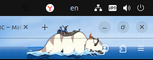
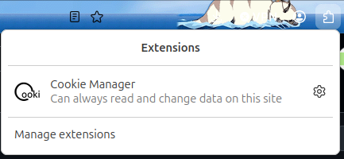
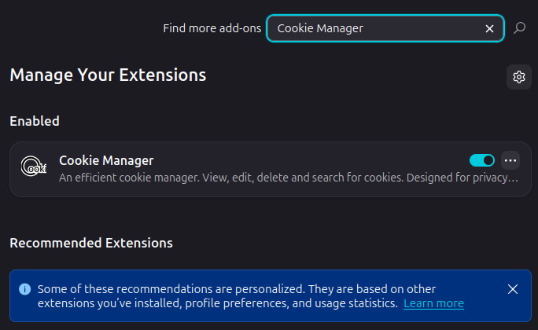
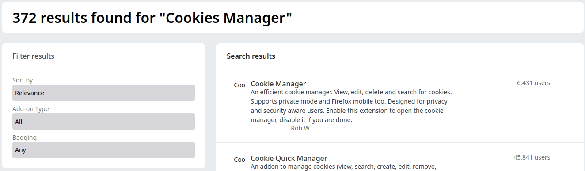
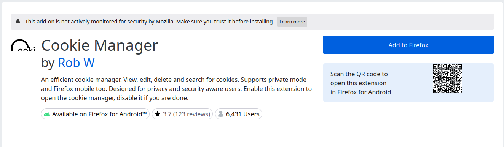
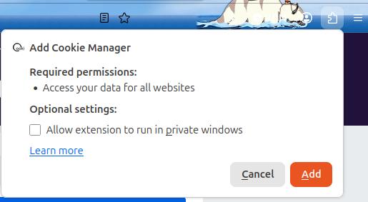

# Для корректной работы парсера необходимо установить в браузер расширение "Cookie manager". Описание предоставлено для браузера "Mozila Firefox".

## 1. В правом верхнем углу браузера нажать на иконку пазла:
 
## 2. В появившемся окне нажать кнопку "Manage extensions".

## 3. В окне управления расширениями в поле поиска ввести "Cookie manager":

## 4. В результатах поиска выбрать первый (самый верхний) вариант:

## 5. В окне самого расширения нажать "Add to Firefox":

## 6. После корректной загрузки дать разрешение на добавление расширения в браузер (кнопка "Add"):

