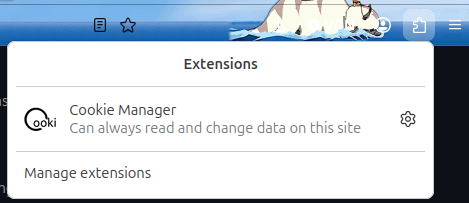
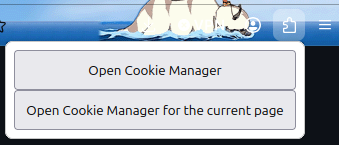
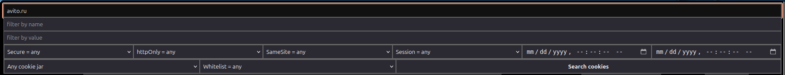
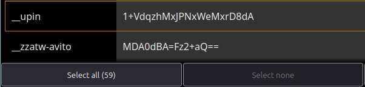
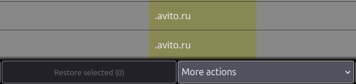
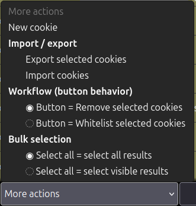
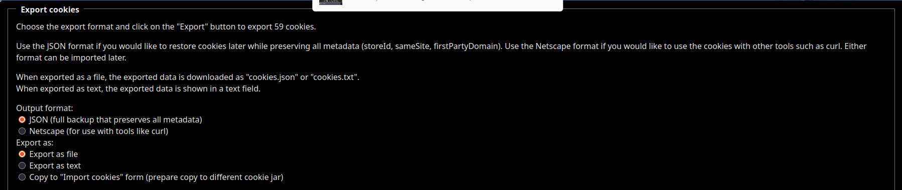

# Порядок экспорта cookies из браузера (при помощи расширения "Cookie Manager" [установка](../browsers/extensions/COOKIE_MANAGER.md))

# 1. В правом верхнем углу браузера нажать на иконку расширений (пазл):

# 2. В открывшемся окне выбрать расширение "Cookie Manager".
# 3. Появится окно управления расширением: 

# 4. В нем выбрать "Open Cookie Manager".
# 5. В открывшемся окне настроек в поле "Filter" ввести "avito.ru":

# 6. После в левом нижнем углу нажать кнопку "Select all":

# 7. Далее необходимо нажать на "More action":

# 8. После чего появится окно с настройками:

# 9. В этом окне необходимо нажать на "Export selected cookies".
# 10. После появится окно с настройками экспорта: 

# в котором нужно выбрать:
    * JSON.
    * Export as file.
# Далее, нажать на кнопку "Export" в левом нижнем углу. После чего скачанный файл cookies.json скопировать в корень проекта.